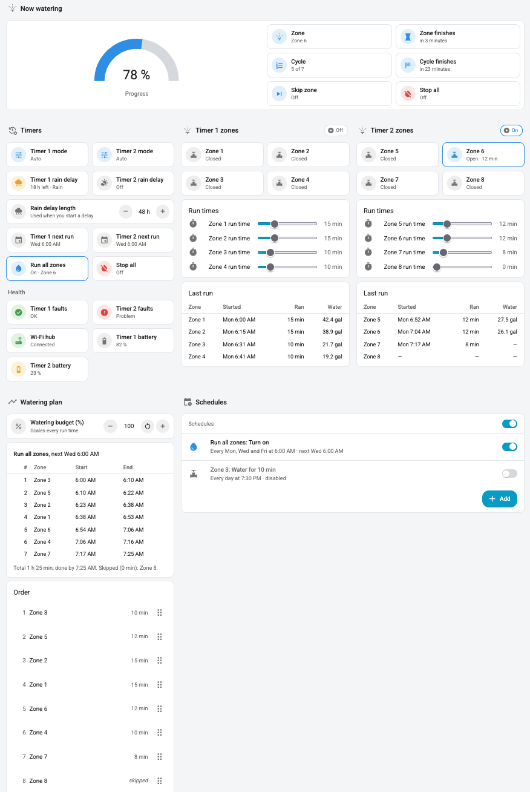

# Irrigation

An Irrigation dashboard and the scripts behind it for two 4-zone B-hyve timers (8 zones). Set each zone's run time, drag the zones into order, and give the whole series one start time; each zone starts when the one before it finishes. The page also shows what's watering now, the plan for the next run, rain delays, timer health and each zone's last run.

[`preview/irrigation-preview.html`](../preview/irrigation-preview.html) is a standalone mock of the page with sample data (the screenshot above is taken from it). Open it in a browser to try the layout before installing.

## Files

| File | What it is |
|---|---|
| [`packages/irrigation.yaml`](../packages/irrigation.yaml) | Helpers, scripts and template sensors |
| [`dashboards/home/views/irrigation.yaml`](../dashboards/home/views/irrigation.yaml) | The Irrigation page (a view of the Home dashboard) |
| [`www/bhyve-zone-order-card.js`](../www/bhyve-zone-order-card.js) | Drag-and-drop card for the zone order |
| [`preview/irrigation-preview.html`](../preview/irrigation-preview.html), `.png` | Standalone preview and its screenshot (not needed in HA) |

## Requirements

- The shared setup in the [repo README](../README.md#setup).
- Home Assistant 2024.10 or newer.
- From HACS:
  1. **B-hyve** integration: https://github.com/sebr/bhyve-home-assistant
  2. **Scheduler component** (runs the schedules): https://github.com/nielsfaber/scheduler-component. After installing, add it under Settings → Devices & services.
  3. **Scheduler card** (the schedule editor on the page): https://github.com/nielsfaber/scheduler-card

## Setup

1. **Copy the files** listed above into `/config`, keeping their paths.
2. **Rename your B-hyve entities** to the IDs in [Entity IDs](#entity-ids) below. Then the files need no edits.
3. **Restart Home Assistant.**
4. **Register the Order card** as a dashboard resource (once): URL `/local/bhyve-zone-order-card.js`, type **JavaScript module**. See [Custom cards](../README.md#custom-cards) for where.
5. **Set it up on the page:**
   - Set each zone's run time with its slider.
   - Drag the zones into order in the Watering plan section.
   - In Schedules, add one schedule for **Run all zones** (or a timer cycle) at the time you want watering to start.
   - Turn off the B-hyve app's own programs (`switch.*_program` in HA) so the timer and HA don't both water.

## Entity IDs

The easiest setup is to **rename your B-hyve entities to match** these IDs: open Settings → Entities, select the entity, click the gear icon and edit "Entity ID". Give the zones friendly names (e.g. "Front lawn") in the same dialog; the page uses them everywhere.

| Entity ID | What it is |
|---|---|
| `valve.bhyve_zone_1` … `valve.bhyve_zone_4` | Timer 1 zones |
| `valve.bhyve_zone_5` … `valve.bhyve_zone_8` | Timer 2 zones |
| `switch.bhyve_timer_1_rain_delay`, `switch.bhyve_timer_2_rain_delay` | Rain delay |
| `select.bhyve_timer_1_mode`, `select.bhyve_timer_2_mode` | Timer mode (auto/off) |
| `sensor.bhyve_timer_1_next_watering`, `sensor.bhyve_timer_2_next_watering` | Next watering |
| `sensor.bhyve_zone_1_history` … `sensor.bhyve_zone_8_history` | Zone history (last run, minutes, gallons) |
| `binary_sensor.bhyve_timer_1_fault`, `binary_sensor.bhyve_timer_2_fault` | Station faults |
| `binary_sensor.bhyve_hub_connected` | Wi-Fi hub online (only if you have a hub) |
| `sensor.bhyve_timer_1_battery`, `sensor.bhyve_timer_2_battery` | Battery level (only on battery-powered timers) |

The history, battery and connectivity sensors are marked as diagnostic, so look under the device's Diagnostic list if they don't appear in the main one. If you have no Wi-Fi hub or your timers aren't battery-powered, skip those rows: the page hides tiles for entities that don't exist.

The scripts find a zone's helpers from its valve's ID (`valve.bhyve_zone_3` → `input_number.bhyve_zone_3_minutes`), so keep the valve IDs as listed.

### Created by the package

| Entity ID | What it is |
|---|---|
| `input_number.bhyve_zone_N_minutes` | Zone run time, 0–60 min (0 skips the zone) |
| `input_number.bhyve_zone_N_order` | Zone position in a cycle, 1–8 (set by the Order card) |
| `counter.bhyve_watering_budget` | Watering budget, 10–200 % (starts at 100) |
| `input_number.bhyve_rain_delay_hours` | Length of a rain delay started from the page |
| `script.bhyve_run_all`, `script.bhyve_timer_1_cycle`, `script.bhyve_timer_2_cycle` | Cycles: all zones, or one timer's zones |
| `script.bhyve_run_zones` | Runs a list of zones in order (every cycle goes through it) |
| `script.bhyve_water_zone` | Waters one zone |
| `script.bhyve_skip_zone`, `script.bhyve_stop_all` | Skip to the next zone; stop everything |
| `script.bhyve_toggle_rain_delay` | Starts or cancels a rain delay |
| `sensor.watering_zone`, `sensor.watering_progress`, `sensor.watering_ends` | The zone watering now, its progress and end time |
| `sensor.watering_cycle`, `sensor.watering_cycle_ends` | Position in the running cycle ("3 of 6") and its end time |
| `sensor.watering_order` | Zone order and budget-scaled run times |
| `sensor.timer_1_rain_delay_status`, `sensor.timer_2_rain_delay_status` | Rain delay time left and reason |

## The Irrigation page

From top to bottom:

- **Now watering** (only while a zone is open or a cycle is running): which zone, a progress gauge, and when it finishes. During a cycle it also shows where you are ("3 of 6") and when the whole cycle finishes, and it stays up between zones. It works no matter what started the zone: a cycle, a tile, a schedule or the B-hyve app. The gauge moves once a minute.
  - **Skip zone** ends the zone that's watering. In a cycle, the next zone starts about 5 seconds later instead of waiting out the rest of the run time.
  - **Stop all** cancels running and queued cycles and closes every zone.
- **Timers**
  - Each timer's mode and next run.
  - **Rain delay**: shows time left and the reason ("18 h left · Rain"). Tap to start a delay of the length set below it (24–168 h), or to cancel the one running.
  - **Run all zones** and **Stop all**.
  - **Health**: fault status for each timer, the Wi-Fi hub's connection and each timer's battery.
- **Timer 1 zones / Timer 2 zones**
  - **Zone tiles**: tap to water that zone for its run time, hold for details.
  - **Run times**: a slider per zone.
  - **Last run**: when each zone last watered, for how long, and how much water it used. Water shows "—" if B-hyve doesn't report it.
- **Watering plan**
  - **Watering budget**: scales every run time, for seasonal changes. Reset puts it back to 100 %.
  - **Plan**: the next scheduled cycle with each zone's start and end time, the total, and when it finishes. It updates as you change run times, the order or the budget, and notes skipped zones and rain delays. With no cycle scheduled, times show as offsets from the start (+0:15).
  - **Order**: drag the zones into order (on a keyboard, focus a handle and use the arrow keys).
- **Schedules**: the Scheduler card. See [Schedules](#schedules).

## How cycles work

- Only one zone waters at a time, across both timers.
- **Run all** waters all eight zones; **Timer 1** and **Timer 2** water just that timer's four. All of them follow the order from the Order card, lowest position first. Zones with the same position go by zone number.
- Each zone waters for its run time **scaled by the budget**, then the next zone starts after a 30-second buffer. A zone set above 0 always gets at least 1 minute.
- Zones with a run time of 0 are skipped, and so are a timer's zones while its rain delay is on.
- Every cycle goes through one queued script, so if two cycles start together, the second waits for the first to finish.
- Tapping a zone tile also uses the budget-scaled run time.

## Schedules

In the Schedules card you can schedule:

- a **cycle** (recommended): one start time waters the zones in order, and you change the durations with the sliders and the budget, or
- a **single zone** with "Water for N minutes". This time isn't scaled by the budget.

Single-zone schedules don't go through the queue. Space them at least as far apart as the run time, or they'll overlap.

The schedules run in Home Assistant, so nothing waters while HA is down. The B-hyve app's own programs run on the timer itself. Turn those programs off (the integration exposes them as `switch.*_program`) so the two don't both water.

## Updating

See [Updating](../README.md#updating) for the general rules. For this page, a change to `packages/irrigation.yaml` needs Scripts, Input numbers, Counters and Template entities reloaded (Developer tools → YAML), or a restart if it adds a new kind of helper.

## Troubleshooting

- **"Custom element doesn't exist: bhyve-zone-order-card"**: the card isn't registered (setup step 4), or the browser has an old copy cached. Check the resource URL, then refresh with the cache cleared.
- **A tile says "Entity not available"**: a B-hyve entity hasn't been renamed to the ID in the table above.
- **The plan shows +0:15 instead of clock times**: no enabled schedule runs a cycle. Schedules for a single zone don't count.
- **Now watering doesn't appear**: check that `sensor.watering_zone` changes from Idle when a zone opens (Developer tools → States). If it stays Idle, the valve IDs don't match `valve.bhyve_zone_N`.
- **Times are off by a minute**: each zone's start includes the 30-second buffer after the zone before it, and times are rounded down to the minute.
